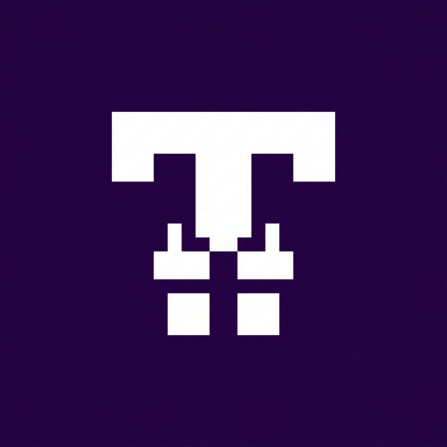
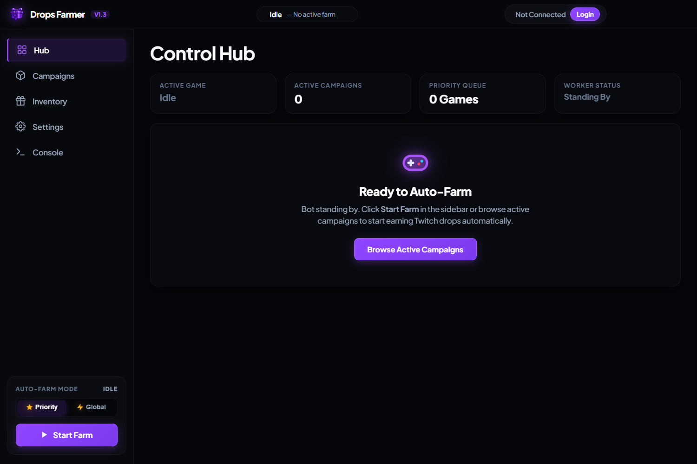
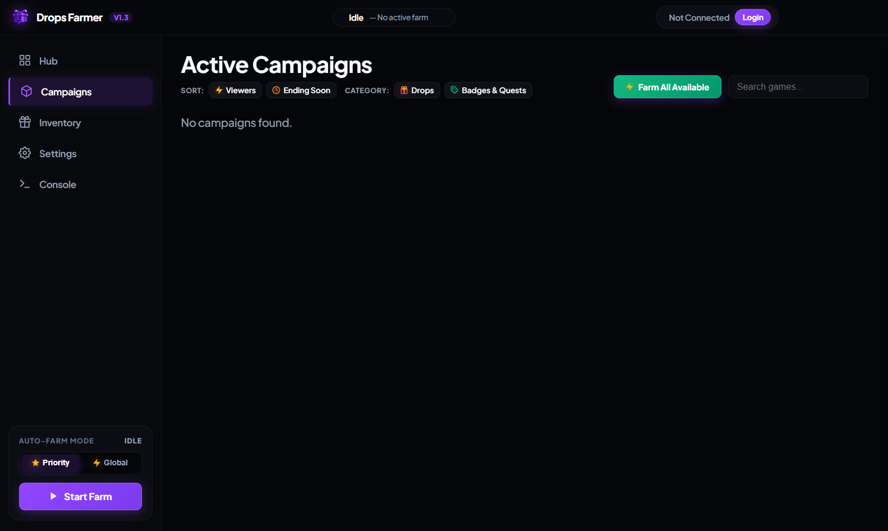
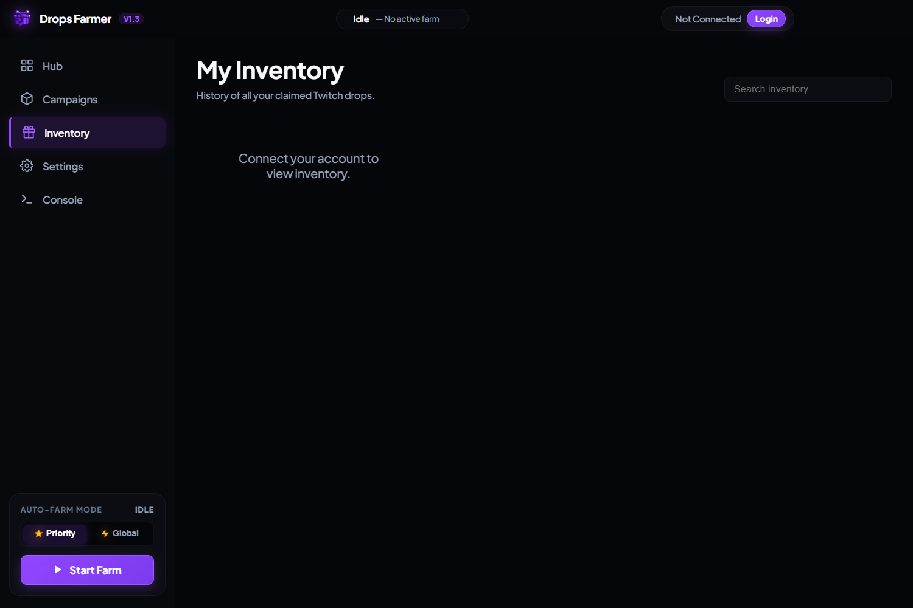
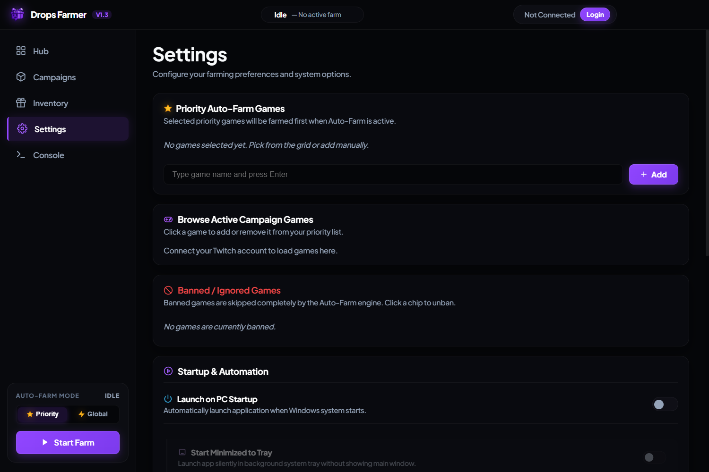

<div align="center">
  

  <h1>Twitch Drops Farmer PRO</h1>

  <p><strong>Farm and claim Twitch Drops from your Windows desktop.</strong></p>

  <p>
    <a href="package.json"></a>
    <a href="https://github.com/lokalizator-repo/TwitchDropsFarmer/releases"></a>
    <a href="package.json"></a>
  </p>

  <p><a href="https://github.com/lokalizator-repo/TwitchDropsFarmer/releases/download/v1.3.0/TwitchDropsFarmer_v1.3.0.exe">Download v1.3.0 for Windows</a> · <a href="https://github.com/lokalizator-repo/TwitchDropsFarmer/releases">All releases</a></p>
</div>

Choose the games you want drops for, set their priority, and let the app find a stream and track progress in the background.
## Getting started

1. Download and run `TwitchDropsFarmer_v1.3.0.exe`. It's portable, so there's no installer.
2. Click **Login** and sign in to Twitch.
3. Choose **Priority** to farm games from your priority list, or **Global** to farm available campaigns.
4. Click **Start Farm**. Progress and stream activity appear in the Control Hub.

You can set game priorities and exclude games in Settings. Windows startup, launching to the tray, and starting farming on launch are optional.

## Features

- Finds live channels with drops enabled and switches streams when needed.
- Gives preferred games priority when their campaigns are available.
- Lets you skip a streamer without changing the target game.
- Tracks campaign progress and claimed rewards in the inventory.
- Automatically claims completed drops when auto-claim is enabled.
- Supports game and campaign exclusions.
- Can show the current game, channel, and drop progress on Discord.

## Screenshots

### Control Hub

The current stream, drop progress, and activity log.



### Campaigns

Available campaigns and their rewards.



### Inventory

Drop progress and claimed items.



### Settings

Game priorities, exclusions, startup options, and notifications.



## Running from source

You'll need Node.js and npm. The app uses Electron 32.

```sh
git clone https://github.com/lokalizator-repo/TwitchDropsFarmer.git
cd TwitchDropsFarmer
npm install
npm start
```

To build the portable Windows executable:

```sh
npm run dist
```

The build is saved to `dist/TwitchDropsFarmer_v1.3.0.exe`.

## License

ISC, as declared in [package.json](package.json).
